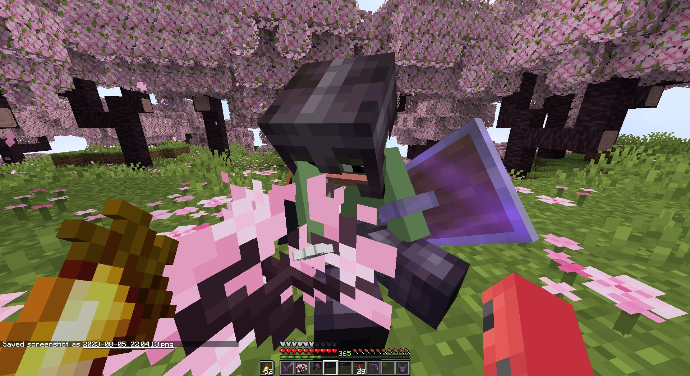
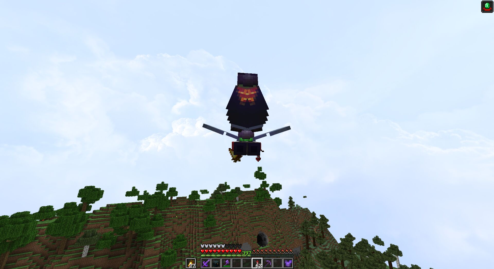
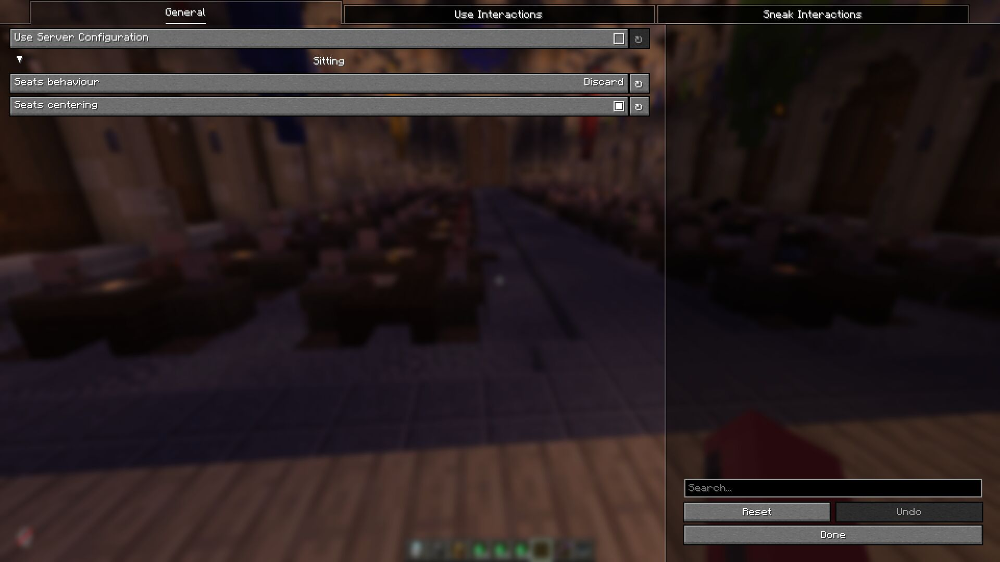

# FSit Continued

> [!IMPORTANT]
> This is a community continuation of [FSit](https://modrinth.com/mod/fsit) by rvbsm, who has been unreachable for an extended period.
> This project exists solely to keep the mod alive and updated for newer Minecraft versions.
> **It will be taken down immediately if the original author returns and contacts us.**
> All credit for the original mod goes to rvbsm. Licensed under MIT.

Customizable server-side mod that allows players to sit, crawl, and ride each other.
Client-side is supported too,
it allows players to improve their experience by using client configuration
and adding some client-side mod behaviour improvements.
> [!NOTE]
> Inspired by [GSit](https://github.com/Gecolay/GSit) Spigot plugin.

## Usage

Having this mod installed on the server is enough, players are not forced to have it to be able to use it.

However, installation on the client will bring some QoL improvements for players using this mod.
Such as client configuration, better crawling, and key bindings.

### Interacting with blocks

Interact with the topside of the block, that can be sat on, to start sitting on them.



Controlled with [`sitting.enabled`](#sittingenabled).

### Interacting with players

Interact with any player to start riding them.
Clicking anyone in a riding stack will mount you on the topmost player.



Control angle difference with [`riding.max-yaw-difference`](#ridingmax-yaw-difference).

### Sneaking

Double sneak while looking down to sit right away.

Doing the same, but near the hole, will start crawling otherwise.
([`sneak-activation.prefer-crawl-in-tight-space`](#sneak-activationprefer-crawl-in-tight-space))

Minimal pitch and the sneak window can be configured with
[`sneak-activation.min-pitch-down`](#sneak-activationmin-pitch-down) and
[`sneak-activation.window-ticks`](#sneak-activationwindow-ticks) accordingly.

### Commands

Pose commands:

- `/sit` — sit down where you stand
- `/crawl` — start crawling
- `/lay` — lay down (experimental)

Mod commands under `/fsit`:

- `/fsit reload` — re-read the configuration file (op only)
- `/fsit mount-angle set <0..180>` / `/fsit mount-angle query` — adjust `riding.max-yaw-difference` at runtime (op only)
- `/fsit hands add <item|#tag>` / `remove` / `clear` / `reset` / `list` — your own list of items that don't count as a "full" hand for the sit/mount checks.
  Defaults to torch and totem of undying, so you can hold them and still sit down.
  Available to every player, list is saved per-player.
- `/fsit teleport <vanilla|disabled|enhanced>` / `/fsit teleport query` — what happens to anyone sitting on you when you teleport (op only, server-wide):
  - `vanilla` — passengers ride along same-dimension, get left behind on cross-dimension teleport
  - `disabled` — passengers are dropped before the teleport
  - `enhanced` — passengers follow you, including across dimensions (recommended)

### Key bindings (client)

Use key bindings to start sitting (default: RCtrl) or crawling (default: RAlt).

Key bindings have three modes: **Hold**, **Toggle**, and **Hybrid**.
**Hold** and **Toggle** works the same as Vanilla.
**Hybrid** is an in-between mechanic, that works as Toggle on single-use and as Hold on holding.
The **Hybrid** window between **Hold** and **Toggle** can be configured from the Configuration Screen.

## Configuration

As was stated before, players can use their own configurations if they have this mod installed on the client.
Otherwise, server configuration will be used.

Configuration can be reloaded from the file with `/fsit reload`.

For clients, configuration can be modified with [Mod Menu] and [YetAnotherConfigLib] installed.



### Default configuration file

```yaml
# FSit configuration. Do not edit `version` by hand.
# On a dedicated server: `/fsit reload` re-reads this file.
# On the client: reloading local config requires a game restart.
version: 2
use-server-config: false
# Sitting on blocks (e.g. slabs, stairs).
sitting:
  enabled: true
  behavior: moveable
  centered: false
  blocks:
    - '#minecraft:slabs'
    - '#minecraft:stairs'
    - '#minecraft:logs'
    - '#minecraft:fences'
    - '#minecraft:walls'
# Riding other players (interact with a player to sit on their head).
# teleport-mode is server-wide (ops only). Possible values:
#   vanilla   -> let teleports happen as-is (passengers ride along same-dim,
#                stay behind on cross-dim — and may crash without 'enhanced')
#   disabled  -> drop passengers before any teleport
#   enhanced  -> carry passengers along, including across dimensions (recommended)
riding:
  enabled: true
  max-yaw-difference: 180
  teleport-mode: vanilla
# Double-sneak shortcuts for entering sit/crawl poses.
sneak-activation:
  enabled: true
  window-ticks: 10
  min-pitch-down: 60
  prefer-crawl-in-tight-space: true
# Commands.
#   true       -> enabled with default name
#   false      -> command is not registered
#   "name"     -> enabled with a custom name (e.g. lay: sleep)
# A server restart is required for command changes to take effect.
commands:
  root: true
  sit: true
  crawl: true
  lay: true
```

<details>
<summary>Options details</summary>

### `use-server-config`

When set to `true`, forces all players (server) or player (client) to use server configuration.

Enabling this option will ignore client pose updates, leaving only server-to-client synchronization.

### `sitting.enabled`

Allows sitting by interacting with blocks.

### `sitting.behavior`

Controls sitting behaviour. Possible values: `static`, `attached`, `moveable`.

* `static` – does nothing, ignores everything;
* `attached` – seats will be discarded if they do not have any supporting block underneath;
* `moveable` – seats can be pushed by fluids, pistons, etc. Will start falling without a supporting block.

### `sitting.centered`

Place seats in the centre of the block.

### `sitting.blocks`

List of blocks and block tags that are available to interact with.

### `riding.enabled`

Allows riding by interacting with other players.

### `riding.max-yaw-difference`

When 1..180, controls the difference between players' horizontal facing angle to allow riding by interaction.
0 disables riding interactions, 180 removes the restriction entirely.

Can also be changed at runtime with `/fsit mount-angle set <0..180>`.

### `riding.teleport-mode`

Server-wide behavior for passengers when a player teleports. Possible values: `vanilla`, `disabled`, `enhanced`.

* `vanilla` – passengers ride along same-dimension, get left behind on cross-dimension teleport;
* `disabled` – passengers are dropped before the teleport;
* `enhanced` – passengers follow you, including across dimensions (recommended).

Can also be changed at runtime with `/fsit teleport <vanilla|disabled|enhanced>` (ops only).

### `sneak-activation.enabled`

Enables double-sneak shortcuts for sitting and crawling.

### `sneak-activation.prefer-crawl-in-tight-space`

Starts crawling instead of sitting if there is a hole nearby.

### `sneak-activation.min-pitch-down`

Minimal required player pitch to start registering sneak actions.
Where 90 is straight down, and -90 ignores player pitch.

### `sneak-activation.window-ticks`

The window in ticks between sneaks to be recognized as double sneak action.
Setting to 0 disables sneak actions.

### `commands.*`

Per-command toggle. Each command (`root`, `sit`, `crawl`, `lay`) accepts:

* `true` – registered with the default name;
* `false` – not registered;
* `"name"` – registered with a custom name (e.g. `lay: sleep`).

A server restart is required for command changes to take effect.

</details>

## Contributing

Pull requests are welcome.  
For major changes, please open an issue first to discuss what you would like to change.

### Translations

New or updated translations are more than appreciated,
they can be found at [src/main/resources/assets/fsit/lang](./src/main/resources/assets/fsit/lang).

Fields with keys `*.description.1` are indefinite and can have any number of lines,
you are free to create new or remove keys with `description.<n>` when needed.

### Building

The project uses [FabricMC] and [Stonecutter] for multi-versioning.

```shell
> ./gradlew build
```

To run a specific version, switch to that version with Stonecutter, and run version configuration provided by IDE, or

```shell
> ./gradlew "Set active project to [version]"
> ./gradlew [version]:runClient # or
> ./gradlew [version]:runServer
```

Publishing is done with `publishMods` task.
Requires `MODRINTH_TOKEN` environment variable to be provided, otherwise the task will dry-run.

```shell
> ./gradlew chiseledPublish
```

## License

This project is licensed under the [MIT License](./LICENSE).

[gsit]: https://github.com/Gecolay/GSit

[mod menu]: [https://modrinth.com/mod/modmenu]
[yetanotherconfiglib]: [https://modrinth.com/mod/yacl]

[fabricmc]: https://docs.fabricmc.net/develop/
[stonecutter]: https://stonecutter.kikugie.dev
